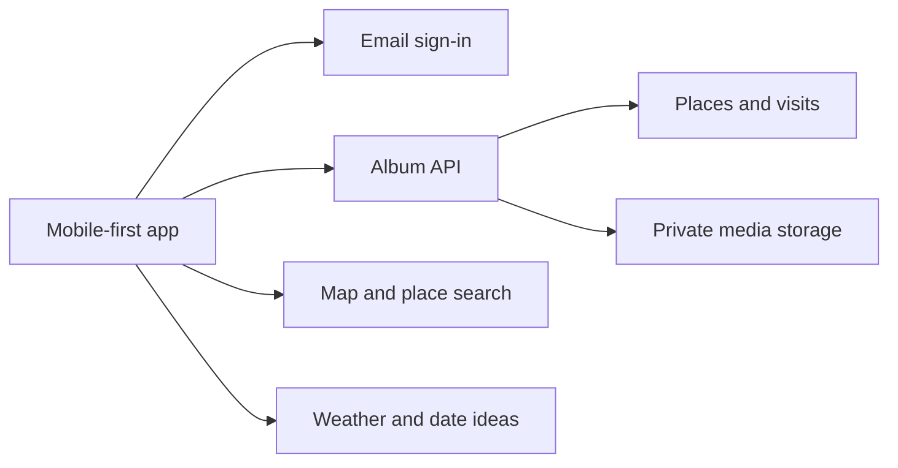

# For Her · MEMORIES

For Her is a private memory album for one couple. It opens on a map of Ireland, where saved places lead back to the visits, photos and short notes that make each place memorable.

**Status** · Phase 2 adds the Ireland map, saved places and dated visit history. Live email delivery and two-device pairing remain pending before private use.

## Product scope

| Area | Planned experience |
| --- | --- |
| Ireland home | Open on an Ireland-wide map of saved places. Tap a pin or a place in the list to see its visits. Group repeat visits under one place, with a separate date, brief and attachments for each visit. |
| Memories | Add a place, date and a short visit brief or media attachment. Support trips, food and drink, days out and everyday moments. Browse visits chronologically in Memories. |
| Photos | Browse photos from across the album in Polaroid-style frames. Open a photo to return to its visit. |
| Date ideas | Browse web-backed places and activities for couples, starting in Dublin. Show the original source link and let a completed outing become a memory through **We went here**. |
| Couple access | One shared album with two separate sign-ins. Both distinct email addresses must be verified and both partners must accept the pairing before the album unlocks. |

The interface follows the approved modern, photo-first direction with clean typography, a green nature palette and Polaroid photo frames. The background reflects weather when the app opens, with subtle cues such as rain and clouds over landscapes with rivers, lakes, ponds and birds. Memories, Places, Photos and Ideas are the main navigation destinations, with the Ireland map as the opening view.

## Proposed architecture



The mobile-first client owns navigation, map interaction and media selection. The backend owns pairing, authorization and shared album records. Map search, weather and date ideas use separate integrations so an unavailable provider does not prevent the couple from opening existing memories.

Phase 1 uses Expo and React Native for the client and Supabase Auth, Postgres and a closed private Storage bucket for the backend. Phase 2 bundles a Natural Earth outline for the Ireland map. Places can be positioned by tapping the map or entering coordinates. External place search, the launch platform and allowed media formats remain open. Open-Meteo is the proposed weather provider.

### Data model

| Entity | Responsibility |
| --- | --- |
| Album | Shared workspace, locked until pairing is complete. The first release provisions one album for one couple. |
| Membership and invitation | Associate two verified sign-in identities with the album. Track a pending invitation until it is accepted, expires or is revoked. |
| Place | Store a reusable map pin with a display name, coordinates and optional region or provider reference. Ireland is the opening map extent. The model supports places abroad. |
| Visit | Store the place, visit date, category, author and optional brief. Require a non-empty brief or at least one successfully attached media item before a visit becomes visible. |
| Attachment | Belong to a visit and reference a private media object. Track media type and processing state so failed uploads can be retried. |
| Date idea | Store the place or activity, region, source URL and last verification date. An idea can prefill a visit for the couple to review and save. |

### Access, media and integrations

- **Pairing.** Bind a single-use, expiring invitation to the intended second email. Activate the album only after both distinct identities are verified and paired. Enforce the two-member limit and album access on the server, including during simultaneous invitation attempts.
- **Private records and media.** Apply active membership checks to every album read and write, including direct media access. Store files privately and issue short-lived access links after authorization. Use synthetic records and sample imagery in development.
- **Uploads.** Keep uploads pending until validated and attached to a visit. Give users a retry path and clean up abandoned uploads. Keep attachment deletion and album access revocation in the release checks.
- **Map.** Request search results for places the user looks up, then store confirmed pins with the album. Keep a place list available when map tiles fail. Global coverage and an offline map are follow-up proposals. Offline tile rights, region size and download behavior remain open.
- **Weather.** Refresh conditions at launch using Dublin as the initial city. Use a recent cached result or a neutral green scene when weather is unavailable. Weather lookups use a city-level location, keeping saved memory coordinates out of those requests.
- **Ideas.** Start with a curated Dublin list and official or first-party source links. Keep suggestions independent of the album so browsing ideas does not disclose visit history.

## Proposed delivery plan

| Milestone | Deliverable | Done when |
| --- | --- | --- |
| 1. Foundation | App shell, backend, email verification and partner pairing | Code and database checks are complete. Verify email delivery and pairing on a configured Supabase project before first use. |
| 2. Ireland and visits | Ireland home map, place list and visit editor | Implemented. Add dated notes, reopen place history from a pin, and record repeat visits under the same place. Database access and retry checks are covered by the test suite. |
| 3. Media and design | Private uploads, Polaroid gallery, photo-first navigation and weather scenes | A media-only visit opens from the map and gallery. Upload retries, unavailable weather and a failed map load each have a usable fallback. |
| 4. Ideas and private release | Dublin date ideas, **We went here** and testing on both partners’ devices | An idea can become a visit. Pairing, account recovery, access revocation, media deletion and backup recovery have been tested before real memories are added. |

The first release covers the shared album, Ireland home map, visits, gallery, weather and a small set of sourced Dublin date ideas. Wider suggestion coverage and offline maps can follow after the private release.


## Run the app

Use Node.js 22 or newer. Copy `.env.example` to `.env.local` and set the dedicated project URL and publishable key. Only the publishable key belongs in the app environment.

```sh
npm ci
npm run web
```

Use `npm start` for the Expo development server. Sessions are held in memory, so reopening the app or refreshing the web page requires a new sign-in code.

### Provision one couple

1. Apply the [foundation migration](supabase/migrations/20261110120000_album_foundation.sql) to a dedicated Supabase project. For hosted setup, use the SQL editor or the Supabase CLI.
2. Enable the email provider and email confirmation. Disable public signup. Use six- or eight-digit email codes and a ten-minute expiry. Use the supplied [Invite user](supabase/templates/setup_code.html) and [Magic link or OTP](supabase/templates/sign_in_code.html) templates. Configure [custom SMTP](https://supabase.com/docs/guides/auth/auth-smtp) for delivery to the two inboxes. The repository's [local configuration](supabase/config.toml) specifies these auth settings for a local Supabase stack.
3. In the Auth admin interface, send an Auth invitation to each intended email address. Run [pair configuration](supabase/configure_pair.sql) privately with those same normalized addresses to bind the album to the two Auth user IDs. Keep the real addresses out of the repository.
4. Each partner selects **Use first-time setup code** and verifies their email with the code from Supabase. The owner creates and privately shares a separate album invitation code. The partner enters that code and accepts. The owner selects **Check again** to open the album. On subsequent sessions, use **Send sign-in code**.
5. Before adding real memories, verify both emails arrive, both devices can unlock the same album, and a third identity cannot open it. The media bucket is closed to every client in Phase 1.

The sign-in screen uses the same submission message for known and unknown addresses. Treat direct Supabase OTP endpoint behavior as a separate hosted security check, since the provider can return distinct responses to scripted requests. See the [Supabase Auth issue](https://github.com/supabase/auth/issues/1547).

```sh
npm run typecheck
npm test
npm run build
```

The tests execute the production migration in embedded Postgres with minimal Supabase schemas. They verify invitation expiry, rotation and replay protection, the two-user album gate, and storage isolation. Hosted Auth and SMTP require a separate two-inbox test.

## Project logs

The [structured audit trail](docs/logs/README.md) defines 13 log categories, shared change IDs, entry templates and historical coverage tracking. Detailed private records are maintained in the owner's private audit register. Review the recording and visibility rules before adding entries.


## Phase 2 integration

Apply [the places and visits migration](supabase/migrations/20261110220000_places_and_visits.sql) after the foundation migration. Run each migration once in order. If applying through the hosted SQL Editor, run the migration in a transaction and reconcile its migration history before switching to CLI deployment.

Once the album is paired, sign-in opens the Ireland map and place list. Select **Add memory**, name the place, tap the map to position its pin, and enter a date and description. Select a saved pin or its place in the list to open its history. **Add another visit** uses the same place. **Memories** shows the album timeline. **Refresh** retrieves both partners' current records.

The client reads one consistent album snapshot through `read_album`. The `save_visit` RPC creates a place and visit atomically. Retries reuse a request UUID and return the first successful visit. If a save cannot be confirmed, the editor offers **Retry save** with the original input. Returning to the album refreshes its records. Places with the same name and coordinates rounded to five decimal places are reused. Each visit keeps its own date and description.

The map is a bundled regional overview with zoom controls and a complete place list. Places outside its extent remain available in the list. It makes no runtime tile or geocoding requests. The map source and projection are documented in [the geometry notes](src/data/README.md).

Phase 2 requires a description for each visit. Media uploads, photo frames and weather scenes belong to Phase 3. The existing media bucket stays closed to clients.


## Web deployment

The web app is published at [For Her](https://utpal-mishra.github.io/MEMORIES/). Pushes to main run the verification workflow, build the Expo web export and deploy it through GitHub Pages. Pull requests run checks without publishing.

Repository Actions variables supply `EXPO_PUBLIC_SUPABASE_URL` and `EXPO_PUBLIC_SUPABASE_PUBLISHABLE_KEY` during the build. These are public client settings. The database authorization policies protect album contents. The build uses the `/MEMORIES` asset prefix for the repository site.

For another hosting path, update `expo.experiments.baseUrl` in app.json before exporting. Live email delivery and two-device pairing remain acceptance checks for private use.
