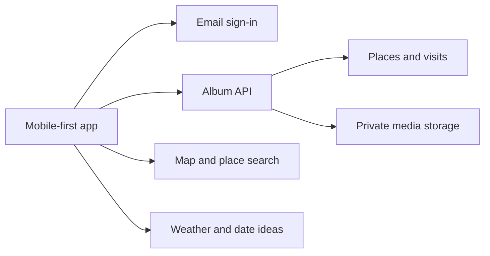

# For Her · MEMORIES

For Her is a private memory album for one couple. It opens on a map of Ireland, where saved places lead back to the visits, photos and short notes that make each place memorable.

**Status** · Product and architecture planning. This repository currently contains the project documentation.

## Product scope

| Area | Planned experience |
| --- | --- |
| Ireland home | Open on an Ireland-wide map of saved places. Tap a pin or a place in the list to see its visits. Group repeat visits under one place, with a separate date, brief and attachments for each visit. |
| Memories | Add a place, date and a short visit brief or media attachment. Support trips, food and drink, days out and everyday moments. Browse visits chronologically in Memories. |
| Photos | Browse photos from across the album in Polaroid-style frames. Open a photo to return to its visit. |
| Date ideas | Browse web-backed places and activities for couples, starting in Dublin. Show the original source link and let a completed outing become a memory through **We went here**. |
| Couple access | One shared album with two separate sign-ins. Both distinct email addresses must be verified and both partners must accept the pairing before the album unlocks. |

The interface follows the approved modern, photo-first direction with clean typography, a green nature palette and Polaroid photo frames. The background reflects weather when the app opens, with subtle cues such as rain and clouds over landscapes with rivers, lakes, ponds and birds. Memories, Places, Photos and Ideas are the main navigation destinations, with the Ireland map as the opening view.

## Proposed architecture

The mobile-first client owns navigation, map interaction and media selection. The backend owns pairing, authorization and shared album records. Map search, weather and date ideas use separate integrations so an unavailable provider does not prevent the couple from opening existing memories.

The initial stack candidates are Expo and React Native for the client and Supabase Auth, Postgres and private Storage for the backend. Validate those choices in the foundation milestone alongside the map provider, launch platform and allowed media formats. Open-Meteo is the proposed weather provider.

### Data model

| Entity | Responsibility |
| --- | --- |
| Album | Shared workspace, locked until pairing is complete. The first release provisions one album for one couple. |
| Membership and invitation | Associate two verified sign-in identities with the album. Track a pending invitation until it is accepted, expires or is revoked. |
| Place | Store a reusable map pin with a display name, coordinates and optional region or provider reference. Ireland is the opening map extent. The model supports places abroad. |
| Visit | Store the place, visit date, category, author and optional brief. Require a non-empty brief or at least one successfully attached media item before a visit becomes visible. |
| Attachment | Belong to a visit and reference a private media object. Track media type and processing state so failed uploads can be retried. |
| Date idea | Store the place or activity, region, source URL and last verification date. An idea can prefill a visit for the couple to review and save. |

### Access, media and integrations

- **Pairing.** Bind a single-use, expiring invitation to the intended second email. Activate the album only after both distinct identities are verified and paired. Enforce the two-member limit and album access on the server, including during simultaneous invitation attempts.
- **Private records and media.** Apply active membership checks to every album read and write, including direct media access. Store files privately and issue short-lived access links after authorization. Use synthetic records and sample imagery in development.
- **Uploads.** Keep uploads pending until validated and attached to a visit. Give users a retry path and clean up abandoned uploads. Keep attachment deletion and album access revocation in the release checks.
- **Map.** Request search results for places the user looks up, then store confirmed pins with the album. Keep a place list available when map tiles fail. Global coverage and an offline map are follow-up proposals. Offline tile rights, region size and download behavior remain open.
- **Weather.** Refresh conditions at launch using Dublin as the initial city. Use a recent cached result or a neutral green scene when weather is unavailable. Weather lookups use a city-level location, keeping saved memory coordinates out of those requests.
- **Ideas.** Start with a curated Dublin list and official or first-party source links. Keep suggestions independent of the album so browsing ideas does not disclose visit history.

## Proposed delivery plan

| Milestone | Deliverable | Done when |
| --- | --- | --- |
| 1. Foundation | App shell, backend, email verification and partner pairing | Two intended identities can unlock one album. Pending and unrelated identities cannot read records or media. |
| 2. Ireland and visits | Ireland home map, place list and visit editor | The couple can add a place, log multiple dated visits to it and open each visit from the same pin. A note-only visit can be saved and reopened. |
| 3. Media and design | Private uploads, Polaroid gallery, photo-first navigation and weather scenes | A media-only visit opens from the map and gallery. Upload retries, unavailable weather and a failed map load each have a usable fallback. |
| 4. Ideas and private release | Dublin date ideas, **We went here** and testing on both partners’ devices | An idea can become a visit. Pairing, account recovery, access revocation, media deletion and backup recovery have been tested before real memories are added. |

The first release covers the shared album, Ireland home map, visits, gallery, weather and a small set of sourced Dublin date ideas. Wider suggestion coverage and offline maps can follow after the private release.
